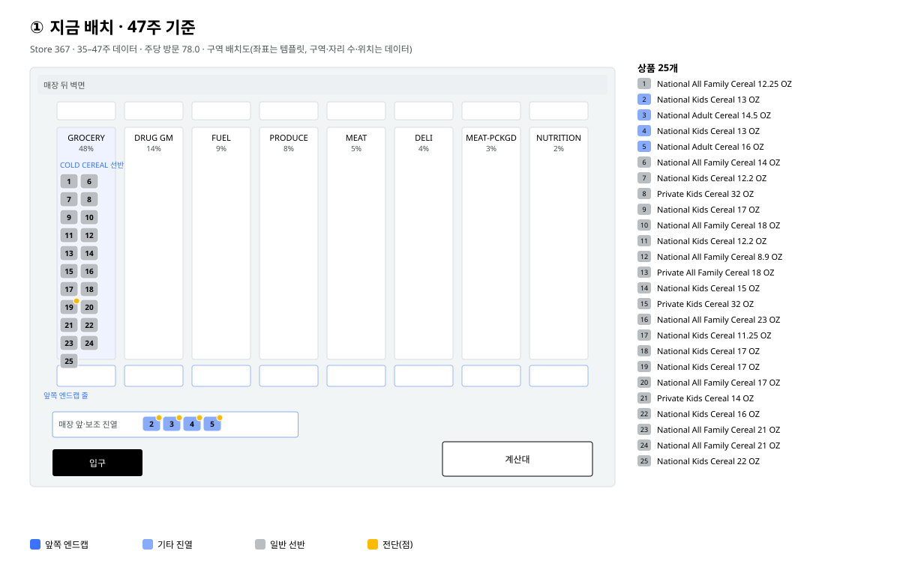
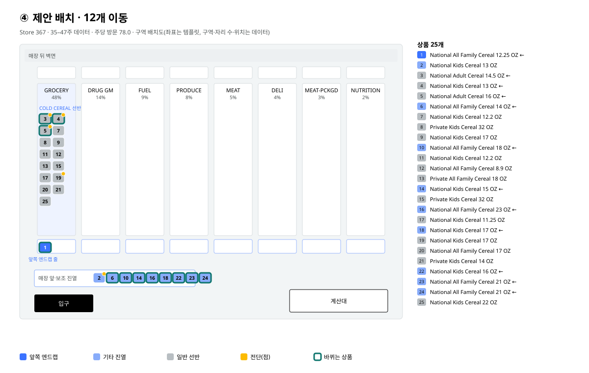

# 한 사이클 · dunnhumby · 매장 367

데이터: dunnhumby Complete Journey (84.51°), completejourney R 패키지 · 가구 2,469 · 매장 457 · 영수증 줄 1,469,307. 결정 표 1,996,300행 (상태 1–26주, 학습 27–44주, 보정 45–47주, 시험 48–53주).

매장 선택: 진열 기록이 있고 시험 주 방문이 가장 많은 매장 → **367** (주당 방문 78.0, 가구 127).

## ① 공간맵

35–47주 데이터. 통로 8개(부서 매출 비중), 이 매장이 쓴 진열 9종. 카테고리에 쓸 수 있는 자리(바쁜 주 90%): 앞쪽 엔드캡 1, 기타 진열 9. 47주 현재: 앞쪽 엔드캡 0개, 기타 진열 4개, 선반 21개. 좌표는 템플릿이고 구역·자리 수·위치만 데이터.

## ② 시뮬레이션 · 같은 손님, 같은 운

실제 방문 446회 · 가구 95 · 결정 11,150건 · 추첨 200번. 기준선 = 47주 배치 고정.

| 안 | 기대 판매 방문 | 90% 범위(손님 운) | 매출 | 기준선 대비 | 기준선보다 많은 추첨 |
|---|---|---|---|---|---|
| 실제 진열 그대로 | 11.8 | 7–17 | $41.65 | ×0.88 (-1.6, $-2.26) | 14% |
| 47주 배치 고정 | 13.5 | 8–20 | $43.90 | ×1.00 (+0.0, $+0.00) | 0% |
| 제안 배치 | 19.7 | 13–26 | $72.98 | ×1.46 (+6.2, $+29.08) | 97% |

## ③ 검증 · 이 매장, 본 적 없는 주

실제 진열 그대로 돌린 시뮬레이션 vs 실제 판매: 총 **실제 18 vs 기대 11.8** (90% 7–17 ✗), 주별 5/6주 범위 안, 상품 순위 상관 0.29.

| 주 | 방문 | 실제 | 기대 | 90% 범위 |
|---|---|---|---|---|
| 48 | 75 | 2 | 2.0 | 0–5 ✓ |
| 49 | 74 | 7 | 1.9 | 0–5 ✗ |
| 50 | 78 | 1 | 1.7 | 0–4 ✓ |
| 51 | 81 | 4 | 2.5 | 0–5 ✓ |
| 52 | 81 | 2 | 2.4 | 0–5 ✓ |
| 53 | 57 | 2 | 1.3 | 0–3 ✓ |

전체 매장 검증은 `VALIDATION.md`(`python validate.py`).

## ④ 최종 배치

목표: 매출 최대. 상품마다 선반·앞쪽 엔드캡·기타 진열의 기대값을 같은 방문으로 시뮬레이션하고, 이 매장 자리 수(앞쪽 엔드캡 1, 기타 진열 9) 안에서 배정 문제로 고름. 전단은 공간이 아니라 그대로.

바뀌는 상품 14개:

| 상품 | 지금 | 제안 | 선반 대비 기대 매출 |
|---|---|---|---|
| 1. National All Family Cereal 12.25 OZ | 평소대로 | 기타 진열 | $+6.18 |
| 17. National Kids Cereal 11.25 OZ | 평소대로 | 앞쪽 엔드캡 | $+5.13 |
| 16. National All Family Cereal 23 OZ | 평소대로 | 기타 진열 | $+4.13 |
| 6. National All Family Cereal 14 OZ | 평소대로 | 기타 진열 | $+3.75 |
| 7. National Kids Cereal 12.2 OZ | 평소대로 | 기타 진열 | $+3.51 |
| 14. National Kids Cereal 15 OZ | 평소대로 | 기타 진열 | $+3.43 |
| 23. National All Family Cereal 21 OZ | 평소대로 | 기타 진열 | $+2.55 |
| 9. National Kids Cereal 17 OZ | 평소대로 | 기타 진열 | $+2.55 |
| 18. National Kids Cereal 17 OZ | 평소대로 | 기타 진열 | $+2.53 |
| 10. National All Family Cereal 18 OZ | 평소대로 | 기타 진열 | $+2.40 |
| 2. National Kids Cereal 13 OZ | 기타 진열 | 평소대로 | $+0.00 |
| 4. National Kids Cereal 13 OZ | 기타 진열 | 평소대로 | $+0.00 |
| 3. National Adult Cereal 14.5 OZ | 기타 진열 | 평소대로 | $+0.00 |
| 5. National Adult Cereal 16 OZ | 기타 진열 | 평소대로 | $+0.00 |

제안 vs 47주 배치 고정: 기대 13.5 → 19.7 판매 방문 (×1.46), 매출 $+29.08, 추첨 200번 중 97%에서 기준선보다 많음.

## 읽을 때 주의

- 판매 단위는 "그 상품을 산 방문 수"다. 수량이 아니다.
- 제안 배치의 효과는 시뮬레이션 값이다. 실제로 그 배치를 한 적이 없으니 실제 판매와 직접 비교할 수 없고, 근거는 ③과 전체 검증의 효과 크기 비교뿐이다.
- 백테스트에서 최적화는 48–53주에 실제로 온 방문(누가 언제 왔는지)을 쓴다. 구매 결과(y)는 보지 않지만, 47주 시점에 이 방문 목록을 알 수는 없다.
- 90% 범위는 손님 운만 담는다. 모델 오차는 ③과 `VALIDATION.md`의 실제 비교로만 확인한다.
- 전체 검증에서 모델은 총량을 약 10% 낮게 보고(684 vs 617), 엔드캡이었던 방문의 판매를 낮게 봤다(133 vs 80). 엔드캡 효과 크기(3.66배, 실제 3.18배)는 실제 범위 안이다.
- 맵 좌표는 템플릿이다. 데이터에 도면이 없다. 구역·자리 수·현재 위치만 데이터.
- 진열 코드는 앞쪽 엔드캡(3)만 따로 보고, 나머지 진열은 모델에서 "기타 진열" 하나로 묶인다.
